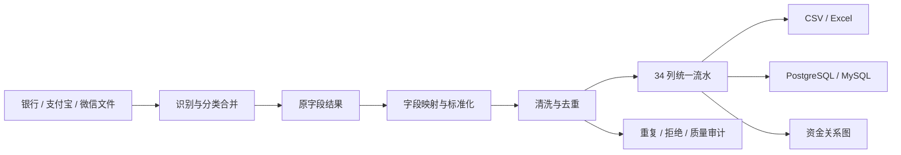
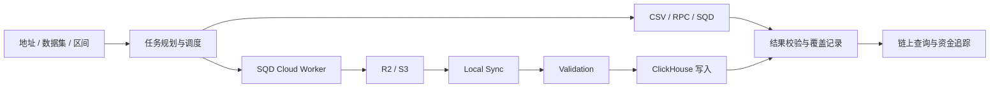

# Funds ETL · 资金数据智能分析平台

**Financial-record normalization and blockchain fund-flow analysis, maintained by LINDUJIAN.**

Funds ETL combines bank, Alipay, and WeChat record processing with blockchain queries, resumable data collection, and interactive transaction graphs. It uses a Go backend and a React/TypeScript frontend, with a 34-field transaction schema and source-linked audit outputs.

[English project overview](docs/PROJECT_OVERVIEW.md) · [Contributing](CONTRIBUTING.md) · [Security](SECURITY.md) · [MIT License](LICENSE)

面向资金调查、交易审计和链上资金追踪，整合银行、支付宝、微信流水整理，以及链上数据下载、查询、分析与可视化。

后端采用 Go + Gin，前端采用 React + TypeScript。一个后端进程同时提供 API 和构建后的前端页面，通过 PowerShell 脚本启动。

## 功能概览

| 模块 | 主要功能 |
| --- | --- |
| 流水整理 | 文件识别、分类合并、字段映射、标准化清洗、去重、质量审计 |
| 数据导入 | CSV、Excel 文件接入，整理结果导入 PostgreSQL 或 MySQL |
| 资金关系图 | 主体与交易关系展示、组合筛选、路径分析、图层、人工标注和多格式导出 |
| 链上查询 | 地址交易、代币转账、合约交互与交易明细，结合 RPC 补充回执信息 |
| 下载中心 | CSV、RPC、SQD、SQD Cloud 数据源调度，任务分片、重试及恢复 |
| 调查分析 | 资金追踪、地址画像、风险分析、案件与调查工作台 |
| 数据质量 | 语义质量、金融质量及历史价格相关功能 |
| 系统设置 | 数据源、并发、上传上限、分析存储和数据保留设置 |

链上数据集的支持范围取决于具体链与 Provider。当前下载和性能验证主要围绕 BSC 展开。

## 快速开始

### 环境要求

- Windows 与 PowerShell，适配仓库提供的启动和部署脚本。
- Go 1.25.0 或更高版本。
- Node.js 20.x 且不低于 20.19.0，或 Node.js 22.12.0 及以上版本；使用 npm 管理前端依赖。
- 链上查询默认使用 ClickHouse，Parquet 校验及部分分析任务需要 DuckDB CLI。

部署前阅读 [安全说明](SECURITY.md)：当前后端默认监听所有网卡，未提供通用登录与多租户隔离。日常使用应限制主机端口访问，远程访问需由带身份认证的网关保护整个应用。

### 安装与启动

```powershell
git clone https://github.com/Euxripides/euripidessss.git
cd euripidessss

cd frontend
npm ci
npm run build
cd ..

.\run.ps1
```

打开 [http://127.0.0.1:8000](http://127.0.0.1:8000)。Gin 直接托管 `frontend/dist`，日常使用不需要单独启动 Vite。

检查服务：

```powershell
Invoke-RestMethod http://127.0.0.1:8000/api/health
```

健康接口的 `status` 应为 `ok`。链上查询和下载还需对应数据库、数据源及 Worker 就绪，可在系统设置、数据源和下载任务页面检查。

### 启动参数

```powershell
# 判断后端是否需要构建，已有健康服务且无需构建时保持现有进程
.\run.ps1

# 使用已有二进制
.\run.ps1 -SkipBuild

# 强制构建后端并启动
.\run.ps1 -ForceBuild

# 强制重启
.\run.ps1 -ForceRestart

# 延长启动等待，适用于历史任务加载较多的环境
.\run.ps1 -StartupTimeoutSeconds 600
```

脚本构建 Windows/amd64 后端，并检查 8000 端口及健康接口。前端需单独执行 `npm run build`。

## 流水整理与资金关系图

支持 `.csv`、`.tsv`、`.txt`、`.xlsx`、`.xlsm`、`.xls`。基础单文件上限为 500 MiB，可通过系统设置调整。

文件按来源识别和分类合并，按处理选项生成原字段结果或统一字段结果。字段映射、列签名和收付方向别名可以保存复用；重复、拒绝记录及质量审计单独输出。



资金关系图支持按主体、对手、时间、金额、方向和标签筛选，查看关联明细、分析路径、管理图层及添加人工标注。可导出图片、Mermaid、DOT、GraphML、draw.io、XMind、CSV 等格式。

### 统一流水字段

统一流水包含 34 个业务字段，与 `internal/etl/etl.go` 中的 `FinalTransactionColumns` 一致。

| 类别 | 字段 |
| --- | --- |
| 本方主体 | 交易卡号、交易账号、交易户名、交易证件号码、交易方开户行、账户性质 |
| 交易信息 | 交易时间、交易金额、交易余额、收付标志 |
| 交易对手 | 交易对手账卡号、对手账户性质、现金标志、对手户名、对手身份证号、对手开户银行 |
| 交易描述 | 摘要说明、交易币种、交易网点名称、交易发生地、交易是否成功 |
| 凭证与设备 | 传票号、IP地址、MAC地址、对手交易余额、交易流水号、商户流水号、日志号、凭证种类、凭证号、交易柜员号 |
| 来源与反馈 | 备注、查询反馈结果原因、数据来源 |

`交易流水号`和`商户流水号`分别保留平台交易编号与商户订单编号。支付宝的`交易号`映射为`交易流水号`，`商户订单号`映射为`商户流水号`，`消费名称`映射为`摘要说明`。

数据库导入支持 PostgreSQL 和 MySQL，可选择追加或重建、中文或英文列名，以及重复记录处理方式。

## 链上数据下载

Smart Download 以地址、数据集和区间组织任务，结合已有覆盖记录规划分片，管理执行、暂停、恢复、取消和失败重试。

- SQD Cloud 支持聚合同一区块窗口的多地址 Range，再将物理任务结果回写到各逻辑 Range。
- Local Sync、Validation、ClickHouse 三个下游阶段使用有容量上限的队列和固定 Worker 池。
- 运行指标包括请求及错误计数、任务阶段耗时、Worker 状态、队列深度和处理速度。
- 云端结果通过 R2 / S3 交换，本地完成同步、校验、写入及覆盖记录更新。



SQD Cloud Processor Worker 是独立项目，当前默认查找 `E:\Code\Processor-only`。本仓库提供运行时接入、任务调度和结果同步；克隆仓库不会同时安装 Worker 或部署云端服务。

背压诊断当前标记为 `observational_only`，主动降载与恢复控制尚未完成端到端验收。[Local Pipeline 检查记录](docs/local_pipeline_backpressure_gap_report.md)保留了检查时点的状态，后续队列实现以当前源码为准。

## 存储与配置

### 存储分工

| 存储 | 用途 |
| --- | --- |
| 文件系统 | 上传、导出、Parquet、任务清单及审计产物 |
| SQLite | 本地控制面和任务元数据 |
| DuckDB CLI | Parquet 读取、校验及相关分析 |
| ClickHouse | 当前默认的链上查询数据源和链上数据写入 |
| PostgreSQL / MySQL | 流水导入目标 |
| R2 / S3 | SQD Cloud 任务与结果交换 |

### 常用配置

| 环境变量 | 默认值或行为 | 说明 |
| --- | --- | --- |
| `PORT` | `8000` | 后端监听端口 |
| `DEBUG` | 值为 `1` 时启用 | 调试配置 |
| `EXPLORER_DATASOURCE` | `clickhouse` | 可选 `clickhouse`、`duckdb`、`auto` |
| `DUCKDB_PATH` | 自动查找 | DuckDB CLI 路径 |
| `DUCKDB_DATABASE` | 默认分析数据库路径 | DuckDB 数据库文件 |
| `DUCKDB_READER_ENABLED` | `false` | 启用相关 DuckDB / Parquet 分析读取服务 |
| `CLICKHOUSE_CREDENTIAL_FILE` | `E:\database\clickhouse\config\clickhouse.env` | ClickHouse 配置文件 |
| `CLICKHOUSE_ENABLED` | 根据凭据文件配置判断 | 启用 ClickHouse |
| `CLICKHOUSE_REQUIRED` | `false` | 将 ClickHouse 设为必要依赖 |
| `CLICKHOUSE_HOST` / `CLICKHOUSE_HTTP_PORT` | `127.0.0.1` / `8123` | ClickHouse HTTP 连接 |
| `CLICKHOUSE_DATABASE` | `onchain` | ClickHouse 数据库 |
| `CLICKHOUSE_USER` / `CLICKHOUSE_PASSWORD` | 配置文件或环境变量 | 应用账号 |
| `SQD_CLOUD_MODE` | 自动选择运行模式 | SQD Cloud 运行时模式 |
| `SQD_CLOUD_WORKER_DIR` | `E:\Code\Processor-only` | 本地 Processor Worker 项目目录 |
| `SQD_CLOUD_DATA_ROOT` | `E:\codex\bsc_analytics\sqd-cloud` | Cloud 运行时任务和审计目录 |

ClickHouse 连接参数优先读取环境变量，再读取指定凭据文件。系统设置中的持久化选项会覆盖对应启动配置，包括并发、上传上限、分析数据源、ClickHouse 开关及价格引擎开关。

显式使用 `SQD_CLOUD_MODE=cloud` 时，启动脚本要求：

```text
SQD_DEPLOY_KEY
R2_ENDPOINT
R2_BUCKET
R2_ACCESS_KEY_ID
R2_SECRET_ACCESS_KEY
```

密钥通过本机环境或凭据文件配置。`run.ps1` 不会自动加载仓库根目录的 `.env`。

启动脚本的端口检测和健康检查固定使用 8000。通过 `PORT` 更换端口时，应直接运行后端，并同步调整前端开发代理。

### ClickHouse 部署

仓库提供专用 WSL2 发行版 `clickhouse-bsc` 的部署与启动脚本，默认存储目录为 `E:\database\clickhouse`。操作步骤见 [ClickHouse 部署说明](deploy/clickhouse/README.md)。

部署后验证：

```powershell
powershell -NoProfile -ExecutionPolicy Bypass -File .\deploy\clickhouse\verify-clickhouse.ps1
```

验证覆盖 HTTP 健康、基础表结构、`CLICKHOUSE_REQUIRED` 设置，以及应用账号的写入和查询。

### 数据位置

项目内运行数据位于 `backend/data/`，包括上传、输出、日志、分析数据库、控制面和任务状态。系统设置保存在 `backend/config/system_settings.json`。

部分链上模块仍使用固定数据根目录 `E:\codex\bsc_analytics`，价格数据默认位于 `E:\database\price_engine`。迁移机器或磁盘时，需要同时处理这些外部目录；移动项目目录不会迁移已有数据。

## 开发与验证

在两个 PowerShell 终端分别运行后端和前端。

后端（项目根目录）：

```powershell
go run .\cmd\server\
```

前端：

```powershell
cd frontend
npm ci
npm run dev
```

前端开发地址为 [http://127.0.0.1:5173](http://127.0.0.1:5173)，`/api` 默认代理到 `http://127.0.0.1:8000`。

```powershell
# 短测模式
go test ./internal/... -short -count=1 -timeout=3m

# 全量测试，包含耗时较长及依赖外部环境的场景
go test ./internal/... -count=1 -timeout=10m

# 静态检查
go vet ./...

# 后端构建
go build -o bin\etl-server.exe .\cmd\server\

# 前端构建
cd frontend
npm run build
```

基准结果保存在 [benchmark_results](benchmark_results/)，文件中记录工作负载、并发、Span、请求计数和运行结果。

## 代码导航

| 路径 | 内容 |
| --- | --- |
| `cmd/server/` | 服务入口 |
| `internal/api/` | API 路由与功能装配 |
| `internal/scanner/`、`parser/`、`provider/`、`etl/` | 文件识别、解析、清洗与导出 |
| `internal/dbimport/` | PostgreSQL / MySQL 导入 |
| `internal/smartdownload/` | 下载规划、调度和下游流水线 |
| `internal/downloadscheduler/`、`cloudruntime/`、`datasetsync/` | Provider 调度、Cloud 运行时与结果同步 |
| `internal/analysis/duckdb/`、`clickhouse/` | 分析存储接入 |
| `internal/explorer/`、`fundflow/`、`intelligence/` | 链上查询、资金流与调查分析 |
| `frontend/src/` | React 页面、组件与状态管理 |
| `deploy/clickhouse/` | ClickHouse 部署和验证脚本 |
| `tools/cpg/` | 代码属性图生成工具 |

交接和变更历史见 [AI_HANDOFF](docs/AI_HANDOFF.md) 与 [CHANGELOG_AI](docs/CHANGELOG_AI.md)，包依赖及调用关系见 [代码属性图摘要](docs/cpg/summary.md)。

## 维护与参与

维护者：**LINDUJIAN**，GitHub：[Euxripides](https://github.com/Euxripides)。

欢迎贡献文件解析规则、字段映射、数据质量检查、Provider 适配、回归测试和文档。提交问题或补丁前请阅读 [贡献指南](CONTRIBUTING.md)，样例使用合成数据。安全问题按 [SECURITY.md](SECURITY.md) 提供的渠道报告。

2026-10-21 的安全检查发现尚未关闭的依赖告警及历史认证资料，详见 [安全政策](SECURITY.md)。

## 开源许可

项目自有代码及文档采用 [MIT License](LICENSE)，版权署名为 **Copyright (c) 2026 LINDUJIAN**。

第三方依赖保留各自的许可证与版权声明，见 [第三方许可说明](THIRD_PARTY_NOTICES.md)。用户资料、第三方数据及独立部署的外部软件不因本项目的 MIT 许可证而改变其授权条件。
